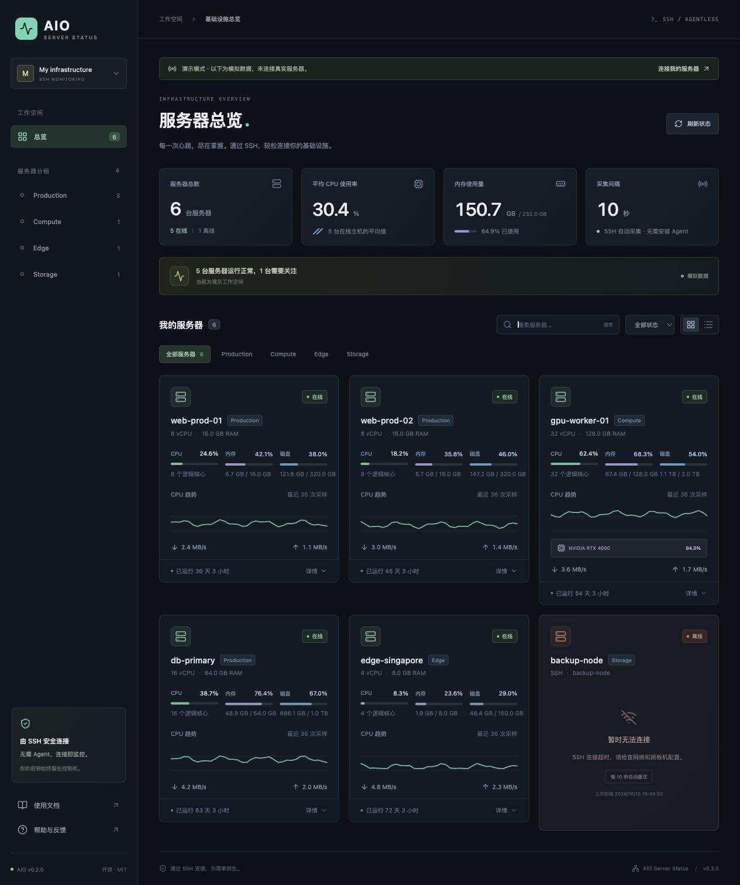

# 只需 SSH，掌握服务器状态

AIO Server Status 是一个轻量的 Linux 服务器监控工具。你只需在控制机上列出 SSH 主机别名，就能通过网页查看多台服务器的 CPU、内存、磁盘、网络和 GPU。

它适合个人服务器、小型集群、实验室 GPU 机器，以及已经维护 `~/.ssh/config`、希望减少安装配置的团队。



## 工作方式

```text
浏览器 ← HTTP → 控制机上的 AIO Server Status
                         ├── SSH → Linux 主机 A
                         ├── SSH → Linux 主机 B
                         └── SSH / ProxyJump → GPU 主机 C
```

控制机每隔 10 秒并发启动固定的只读 shell 采集。目标只需要 sshd、POSIX shell、awk、df、sleep 以及 Linux `/proc`；不需要 Python、sudo、额外 agent 或监控端口。GPU 采集自动使用已有的 `nvidia-smi`。

## 你能看到什么

- 在线、离线和连接中的主机，最近采集时间、连接失败原因。
- CPU / 内存占用、Swap、挂载点磁盘使用情况、系统负载、运行时长。
- 网络接收与发送速率，以及 NVIDIA GPU 利用率、显存和温度。
- 最近 60 次采样的 CPU 趋势；可以搜索、分组、按状态筛选。

## 边界

数据保存在内存中，重启会清空历史。项目不提供持久化、告警推送、进程管理、远程命令终端或用户权限系统。控制机可以是 Linux 或 macOS；被监控目标目前仅支持 Linux。容器中的 `/proc` 可能反映宿主机而非 cgroup 配额。

[开始配置](getting-started.md) · [查看演示](https://hotchilipowder.github.io/aio_server_status/demo/?demo=1)

```{toctree}
:maxdepth: 2
:caption: 使用指南
:hidden:

getting-started
configuration
metrics
deployment
api
troubleshooting
development
```
